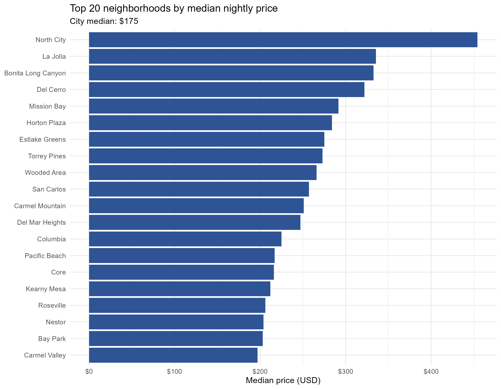

# San Diego Airbnb Market Intelligence

Neighborhood-level short-term rental analysis combining R, Tableau, and a Python review-search assistant.

## What is included

- R cleaning, exploratory analysis, lexicon sentiment scoring, and review-volume forecasting.
- Tableau dashboard and story definitions in `tableau/`.
- A Streamlit RAG assistant that retrieves review excerpts and combines them with neighborhood statistics.
- Original group report and analysis charts.



## Run the assistant

Use Python 3.10+ and run commands from `rag/`:

```bash
cd rag
python -m venv .venv
# Activate the environment for your operating system.
pip install -r requirements.txt
# Copy .env.example to .env and supply your own OPENAI_API_KEY.
python prepare_data.py /path/to/listings.csv /path/to/reviews.csv
python build_index.py
streamlit run app.py
```

Obtain San Diego listings and reviews from [Inside Airbnb](https://insideairbnb.com/get-the-data/). The original analysis uses reviews from 2019–2025; newer snapshots may produce different counts and results. Raw reviews, cleaned listing files, and the embedding index are generated locally rather than distributed here. Indexing and chat use your OpenAI account.

`python eval_airbnb.py` runs the supplied evaluation; it requires the generated index and makes paid API calls. No live API evaluation was rerun during portfolio preparation.

## Tableau and R

Open the `.twb` definitions in Tableau and reconnect the CSV sources. The original workbook includes repeated data connections; use the source names in Tableau to map them to outputs from the R analysis. The R scripts retain the original project paths and should be adjusted to your local data directory. Forecast outputs are produced separately by `Chart 4- Review Volume Forecast.R`.

## Attribution and limitations

The dashboard and report are a Group 11 academic project by Xin Cai, Boon Hun Joshua Gan, Yuhan Luan, Jose Mendoza, and Xinru Tang. The Python RAG extension is presented as Xinru Tang's independent extension. Third-party data remains subject to its source terms.

Review volume is a demand proxy, not confirmed bookings. The assistant samples at most 40 reviews per neighborhood, uses substring neighborhood matching, and requests evidence-grounded answers; this does not guarantee factual correctness or representative sentiment. See `rag/docs/original-project-notes.md` for original implementation notes. Reported historic results have not been reproduced in this packaging pass.
